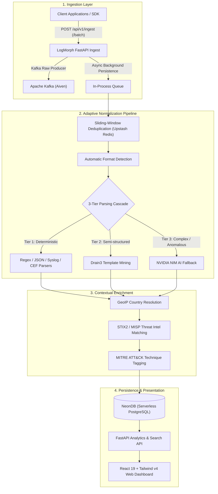

<div align="center">

# 🛡️ LogMorph

**Universal Log Pre-processing, Standardization & Telemetry Intelligence Platform**

[](https://www.python.org/)
[](https://fastapi.tiangolo.com/)
[](https://react.dev/)
[](https://www.typescriptlang.org/)
[](https://pypi.org/project/logmorph/)
[](https://opensource.org/licenses/MIT)
[](https://github.com/astral-sh/ruff)

<p align="center">
  <b>Transform heterogeneous, chaotic logs from any system into standardized, actionable security telemetry in sub-milliseconds.</b>
  <br />
  Featuring a 3-Tier Adaptive Parsing Cascade, sliding-window deduplication, STIX2/MISP threat enrichment, and a zero-dependency Python SDK.
</p>

[Live Cloud API](https://logmorph.onrender.com/health) • [Python SDK Guide](sdk/python/README.md) • [Frontend Web App](frontend/README.md) • [Report Bug](https://github.com/abhaypaul058/MINIproject/issues)

---

</div>

## 📌 Overview & Value Proposition

Modern distributed systems emit logs in dozens of conflicting formats: RFC 3164/5424 Syslog, JSON, Common Event Format (CEF), Log Event Extended Format (LEEF), Apache Combined Log Format (CLF), XML, and raw unstructured stack traces. Ingesting this data into traditional SIEMs or analytical data warehouses results in high compute costs, fragile regex pipelines, and missing security context.

**LogMorph** is an enterprise-ready, multi-tenant log intelligence framework engineered to solve this problem:
1. **Universal Log Schema (ULS)**: Unifies incoming logs into a single, standardized, Pydantic-validated schema.
2. **3-Tier Adaptive Parsing Cascade**: Automatically classifies and parses logs with sub-millisecond execution:
   - **Tier 1 (Fast-Path Rules)**: High-speed deterministic extraction for RFC Syslog, JSON, CEF, LEEF, and Apache CLF.
   - **Tier 2 (Drain3 Template Mining)**: Online template clustering for unstructured logs without predefined schemas.
   - **Tier 3 (AI Fallback Extraction)**: LLM extraction (via NVIDIA NIM) for rare, catastrophic, or anomalous formats.
3. **Sliding-Window Deduplication**: Fingerprints error bursts in real-time via SHA-256 and Redis, achieving up to 60-80% storage and bandwidth reduction during outages.
4. **Contextual Enrichment**: Enriches raw IP addresses and artifacts with MaxMind GeoIP, STIX2/MISP threat intelligence, and MITRE ATT&CK technique tags.
5. **Zero-Dependency SDK (`logmorph`)**: A lightweight client library built exclusively with Python standard libraries for non-blocking log shipping.

---

## 🏗️ Architecture & Pipeline Flow



---

## ⚡ Key Features

| Capability | Technical Mechanism | Benefit |
| :--- | :--- | :--- |
| **Universal Standardization** | Universal Log Schema (ULS) Pydantic Models | Analysis-ready data across Elastic, ClickHouse, Postgres, and BigQuery. |
| **Sub-Millisecond Parsing** | Fast-path regex & compiled token parsers | Average processing latency under **0.08ms per event**. |
| **Noise & Outage Reduction** | Upstash Redis sliding-window fingerprinting | Eliminates duplicate log bursts while preserving exact repetition counts. |
| **Security Context** | GeoIP + STIX2 + MITRE ATT&CK tagging | Flags known malicious IPs, brute-force patterns, and suspicious actions on ingest. |
| **Zero-Dependency Python SDK** | Python standard library (`urllib.request`, `threading`, `queue`) | Zero supply-chain vulnerabilities, zero dependency bloat, instantaneous install. |
| **Multi-Tenant SaaS Security** | Cryptographic API keys (`lm_live_...`) & JWT auth | Complete cryptographic tenant data isolation at the database level. |

---

## 📦 Python SDK Quickstart (`logmorph`)

The official LogMorph Python client is available on [TestPyPI](https://test.pypi.org/project/logmorph/) and [PyPI](https://pypi.org/project/logmorph/).

### Installation
```bash
pip install --index-url https://test.pypi.org/simple/ logmorph
```

### 2-Line Application Integration
```python
from logmorph import LogMorph

# 1. Initialize once with your project API key
logger = LogMorph(
    api_key="lm_live_your_api_key_here",
    source="billing-service",
)

# 2. Log anywhere in your application (Non-blocking background queue)
logger.log("Checkout transaction completed for user #841", level="INFO")
logger.log({"event": "payment_failure", "error_code": 402, "amount": 149.00}, level="ERROR")

# Flushes pending logs cleanly upon process exit automatically
```

### Python Native `logging.Handler` Integration
```python
import logging
from logmorph import LogMorphHandler

app_logger = logging.getLogger("production_app")
app_logger.setLevel(logging.INFO)

# Attach LogMorph handler
handler = LogMorphHandler(api_key="lm_live_your_api_key_here", source="api-gateway")
app_logger.addHandler(handler)

# Standard logging statements now stream directly to LogMorph
app_logger.info("Order processed successfully")
app_logger.error("Database connection timeout")
```

---

## 🛠️ Technology Stack

* **Backend Framework:** Python 3.11+, FastAPI, Uvicorn, SQLModel / SQLAlchemy (AsyncIO)
* **Database Engine:** NeonDB (Serverless Cloud PostgreSQL with connection pool resilience)
* **Caching & Deduplication:** Upstash Redis (Enterprise Serverless Redis)
* **Message Streaming:** Apache Kafka (Aiven Cloud Managed Kafka Free Tier via `aiokafka`)
* **AI Fallback:** NVIDIA NIM API (`nemotron-3.5-bolt-e4b`)
* **Web Frontend:** React 19, TypeScript, Vite 6, Tailwind CSS v4, Lucide Icons
* **Cloud Infrastructure:** Render (Containerized Docker Service), Cloudflare Pages (Frontend SPA)

---

## 💻 Local Development & Server Setup

### 1. Clone Repository & Setup Virtual Environment
```bash
git clone https://github.com/abhaypaul058/MINIproject.git
cd MINIproject

python -m venv .venv
source .venv/bin/activate  # On Windows: .venv\Scripts\activate
pip install -r requirements.txt  # Or: poetry install
```

### 2. Configure Environment Variables
Create a root `.env` file with your credentials:
```env
ENVIRONMENT=development
DATABASE_URL=postgresql+asyncpg://<user>:<password>@<host>/<database>?ssl=require
SECRET_KEY=your_secure_random_secret_key
REDIS_URL=rediss://default:<password>@<host>:<port>
KAFKA_BOOTSTRAP_SERVERS=<host>:<port>
```

### 3. Run Backend API Server
```bash
uvicorn logmorph.main:app --host 0.0.0.0 --port 8000 --reload
```
Navigate to `http://localhost:8000/docs` to view the interactive OpenAPI documentation.

### 4. Run Frontend Dashboard
```bash
cd frontend
npm install
npm run dev
```
Navigate to `http://localhost:5173` to access the live dashboard.

---

## 🧪 Testing & Quality Assurance

LogMorph maintains strict testing hygiene with extensive unit and integration test coverage:

```bash
# Run complete unit test suite
pytest tests/unit/ -v

# Run integration tests (API & Database)
pytest tests/integration/ -v

# Run code style & linting checks
ruff check .
ruff format --check .
```

---

## ⚖️ Legal Disclaimer, Terms & Limitations of Liability

> [!IMPORTANT]
> **READ CAREFULLY BEFORE USING, MODIFYING, OR DEPLOYING THIS SOFTWARE.**

### 1. Open Source License
This software is distributed under the terms of the **MIT License**. You are free to use, modify, copy, merge, publish, distribute, sublicense, and/or sell copies of the software, subject to the conditions detailed in the [LICENSE](LICENSE) file.

### 2. "AS IS" Warranty Disclaimer
THE SOFTWARE IS PROVIDED **"AS IS"**, WITHOUT WARRANTY OF ANY KIND, EXPRESS OR IMPLIED, INCLUDING BUT NOT LIMITED TO THE WARRANTIES OF MERCHANTABILITY, FITNESS FOR A PARTICULAR PURPOSE, TITLE, AND NONINFRINGEMENT. IN NO EVENT SHALL THE AUTHORS, COPYRIGHT HOLDERS, OR CONTRIBUTORS BE LIABLE FOR ANY CLAIM, DAMAGES, LOSS OF DATA, SYSTEM FAILURE, BREACH OF CONFIDENTIALITY, OR OTHER LIABILITY, WHETHER IN AN ACTION OF CONTRACT, TORT, OR OTHERWISE, ARISING FROM, OUT OF, OR IN CONNECTION WITH THE SOFTWARE OR THE USE OR OTHER DEALINGS IN THE SOFTWARE.

### 3. Data Privacy, Compliance & Regulatory Responsibility
LogMorph provides ingestion, pre-processing, sanitization, and parsing mechanisms for telemetry logs. However:
* **User Compliance Responsibility:** The user, organization, or deployment administrator is solely and exclusively responsible for ensuring that all log data ingested, processed, transmitted, or stored using this software complies with all applicable international, federal, state, and local data privacy laws and industry standards, including but not limited to the **General Data Protection Regulation (GDPR)**, **California Consumer Privacy Act (CCPA)**, **Health Insurance Portability and Accountability Act (HIPAA)**, and **Payment Card Industry Data Security Standard (PCI-DSS)**.
* **PII & Sensitive Data Redaction:** While LogMorph includes field sanitization and masking utilities, the authors make no guarantee that all Personally Identifiable Information (PII), Protected Health Information (PHI), or credentials will be automatically identified or masked. Users must configure and audit appropriate ingestion filters and data retention policies prior to processing production logs.

### 4. Security & Availability Notice
* LogMorph is not designed or intended as a certified high-availability fail-safe system for life-critical, medical, emergency, or critical infrastructure operations.
* Cloud deployments (e.g., Render, NeonDB, Upstash, Aiven) are subject to the uptime, availability, security, and rate-limiting policies of their respective third-party infrastructure providers.

### 5. Trademarks
All trademarks, service marks, trade names, product names, and logos appearing in this repository are the property of their respective owners. Mention of third-party platforms (e.g., NVIDIA, Cloudflare, Docker, Redis, Apache Kafka, PostgreSQL) does not imply endorsement or official affiliation.

---

<div align="center">
  <sub>Maintained with pride by <b>Abhay Paul</b> and the LogMorph open source contributors.</sub>
</div>
