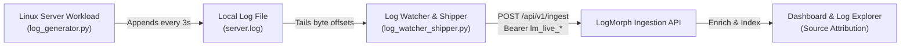

# LogMorph Testing Environment: Server Log Generator & Shipper

A self-contained Linux / local server monitoring environment that continuously generates telemetry events, monitors log files in real time, and automatically ships detected entries to LogMorph.

---

## 1. Directory Structure

```text
testing_environment/
├── .env                    # Server environment variables & API Key
├── .env.example            # Environment template for new deployments
├── server.log              # Local telemetry log file (auto-tailed)
├── log_generator.py        # Periodic server log simulator
├── log_watcher_shipper.py  # Real-time file watcher & HTTP event shipper
├── test_runner.py          # Automated end-to-end validation test runner
└── README.md               # Architecture, setup guide & operational instructions
```

---

## 2. Environment Configuration (`.env`)

Configure your connection settings in `.env`:

```bash
LOGMORPH_API_URL=https://logmorph.onrender.com
LOGMORPH_API_KEY=lm_live_fc9c...
LOGMORPH_SOURCE_NAME=Telemetry-Server-Node
LOG_FILE_PATH=./server.log
LOG_GENERATION_INTERVAL_SEC=3
WATCHER_POLL_INTERVAL_SEC=1
```

---

## 3. How It Works



1. **`log_generator.py`:** Generates RFC 5424 Syslog, auth failures, sudo invocations, firewall packets, and database lock state transitions, appending entries every N seconds.
2. **`log_watcher_shipper.py`:** Continuously tracks byte offsets in `server.log`. When new lines are detected, it immediately sends a `POST /api/v1/ingest` payload to LogMorph with the bound source name (`Telemetry-Server-Node`).
3. **LogMorph Backend:** Accepts the log (`HTTP 202`), generates a unique `event_id`, and routes it through the 3-tier cascade and deduplication pipeline.

---

## 4. Quickstart Guide

### Option A: Run the Automated Validation Cycle
To execute the end-to-end test runner:

```bash
python testing_environment/test_runner.py
```

### Option B: Run as a Standalone Server Process
In terminal 1 (start the log generator):
```bash
python testing_environment/log_generator.py --interval 2.5
```

In terminal 2 (start the log watcher & shipper):
```bash
python testing_environment/log_watcher_shipper.py
```

---

## 5. Understanding the Sources Page (`/sources`)

### Why was `events_count` previously `000`?
1. **Frontend Property Binding (Resolved):**
   - The backend API (`GET /api/v1/sources`) returns `events_count` (plural).
   - The frontend was previously querying `s.event_count` (singular), which evaluated to `undefined` and fell back to `0`.
   - **Fix:** Both `api.ts` and `AppPages.tsx` now read `(s.events_count ?? s.event_count ?? 0)`.
2. **Database Initialization:**
   - In PostgreSQL, the `log_sources` table column `events_count` initializes to `0` when a source is first registered.
3. **How Sources Connect to Telemetry:**
   - When a shipper sends a log with `"source": "Telemetry-Server-Node"`, LogMorph attributes all events to that source name.
   - On the Sources page, clicking **Logs** next to `Telemetry-Server-Node` immediately routes to `/logs?source=Telemetry-Server-Node`, displaying all indexed telemetry for that node.
